# XB Control

XB Control 是面向 Xboard V2 管理 API 的独立 Vue 3 管理端，提供用户、订单、套餐、工单、内容、支付、节点、机器、统计和站点配置等后台功能，并保留 API 工作台供开发调试。

**Vercel 测试站：<https://xbamdin.vercel.app/>**（用于界面与接口测试，尚不代表生产就绪）

> **初期项目提示**：本管理端仍处于初期阶段，可能存在尚未发现的 Bug 或兼容性问题。请先在隔离、可恢复且符合自身安全要求的环境中评估和使用，并在操作真实数据前充分验证。项目 UI、README、API 参考及其他开发文档由 GPT 自动生成，仅供参考；如发现错误或有改进建议，欢迎补充和反馈。

> 页面截图采用浏览器内固定演示响应生成，样例邮箱和域名使用 `.invalid`；截图没有读取或包含真实站点或本机数据库中的数据。按钮和表单仅用于展示界面，没有执行写操作。

## 本机启动

需要 Node.js 18 或更新版本。

```sh
npm install
cp .env.local.example .env.local
# 按需编辑 .env.local 中的 Xboard 地址和管理员安全路径
npm run dev
```

本地开发地址：<http://127.0.0.1:5173/>。`.env.local` 是本机默认配置，改动后重启 Vite。也可以直接在登录页设置连接。公开示例不预填管理员安全路径；该路径会发送到浏览器并编入前端资源，不能当作身份认证或密码使用，也不要把管理员密码、令牌或其他秘密放入 Vite 环境变量。

登录使用 Xboard 管理员账号。密码不会保存；令牌保留在当前浏览器会话的 `sessionStorage`，退出或结束会话后失效。浏览器跨域访问要求 Xboard 允许管理端来源的 CORS 请求；生产环境应使用 HTTPS，或配置同源反向代理。

## Vercel 测试站功能地址与截图

登录后，侧边栏各页面可使用 `/#/<功能名>` 直接打开。下表链接指向 Vercel 测试站；截图可在 GitHub 页面中直接查看或点击放大。

| 功能 | Vercel 测试地址 | 页面截图 |
|---|---|---|
| 连接登录 | [https://xbamdin.vercel.app/](https://xbamdin.vercel.app/) | <a href="docs/screenshots/00-login.png">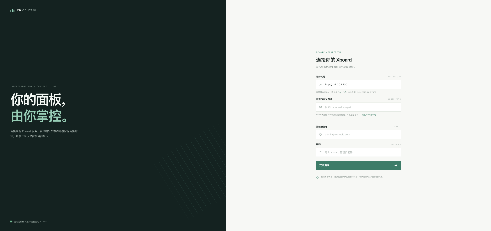</a> |
| 运营概览 | [/#/overview](https://xbamdin.vercel.app/#/overview) | <a href="docs/screenshots/01-overview.png">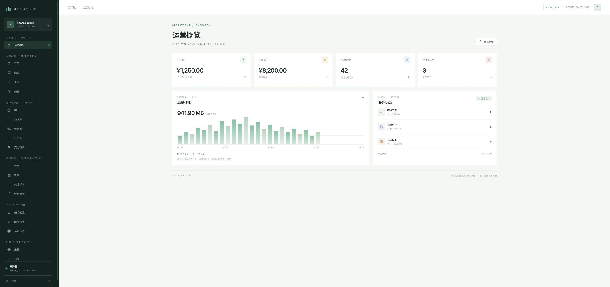</a> |
| 订单 | [/#/orders](https://xbamdin.vercel.app/#/orders) | <a href="docs/screenshots/02-orders.png">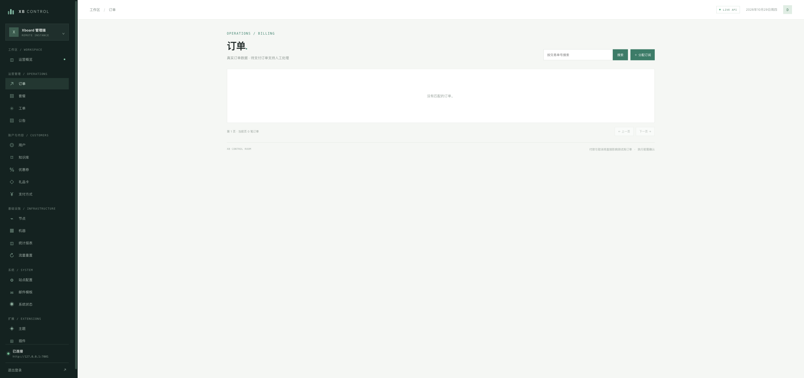</a> |
| 套餐 | [/#/plans](https://xbamdin.vercel.app/#/plans) | <a href="docs/screenshots/03-plans.png">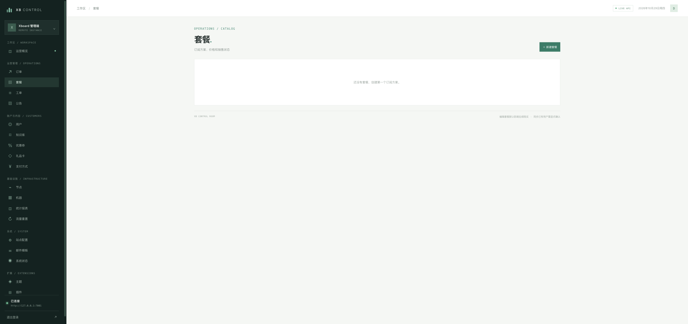</a> |
| 工单 | [/#/tickets](https://xbamdin.vercel.app/#/tickets) | <a href="docs/screenshots/04-tickets.png">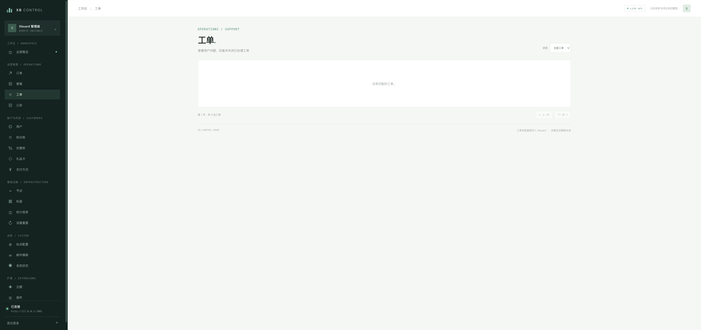</a> |
| 公告 | [/#/notices](https://xbamdin.vercel.app/#/notices) | <a href="docs/screenshots/05-notices.png">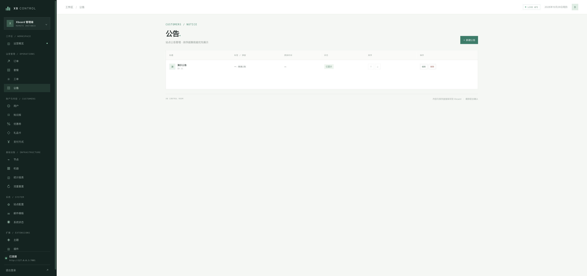</a> |
| 用户 | [/#/users](https://xbamdin.vercel.app/#/users) | <a href="docs/screenshots/06-users.png">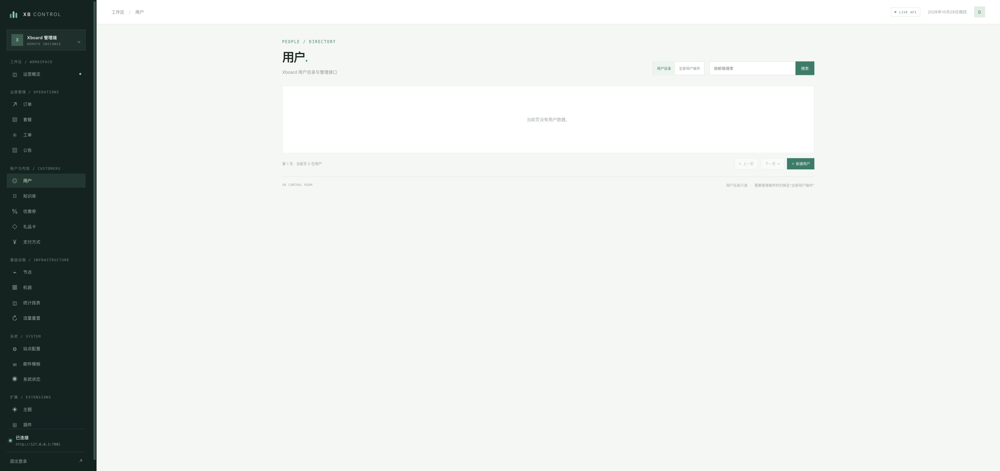</a> |
| 知识库 | [/#/knowledge](https://xbamdin.vercel.app/#/knowledge) | <a href="docs/screenshots/07-knowledge.png">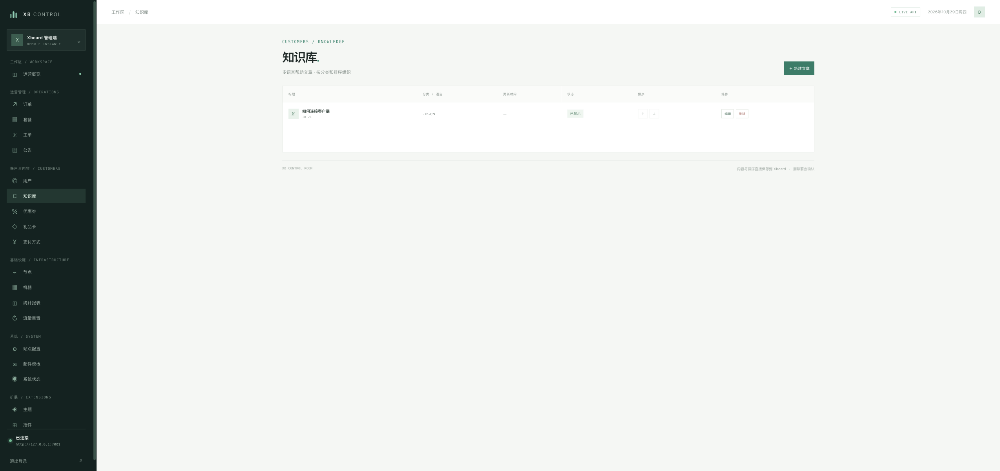</a> |
| 优惠券 | [/#/coupons](https://xbamdin.vercel.app/#/coupons) | <a href="docs/screenshots/08-coupons.png">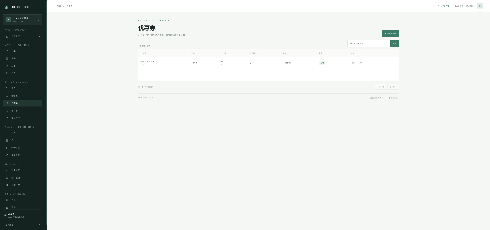</a> |
| 礼品卡 | [/#/gift-cards](https://xbamdin.vercel.app/#/gift-cards) | <a href="docs/screenshots/09-gift-cards.png">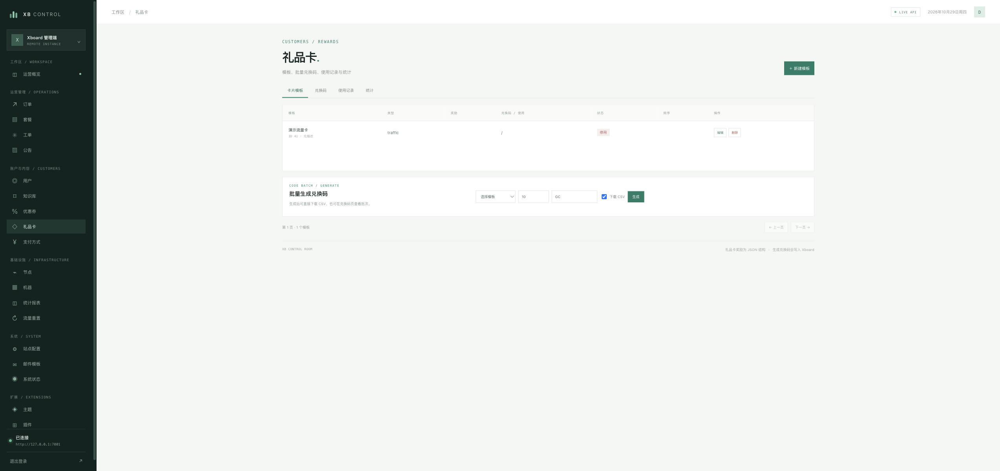</a> |
| 支付方式 | [/#/payments](https://xbamdin.vercel.app/#/payments) | <a href="docs/screenshots/10-payments.png">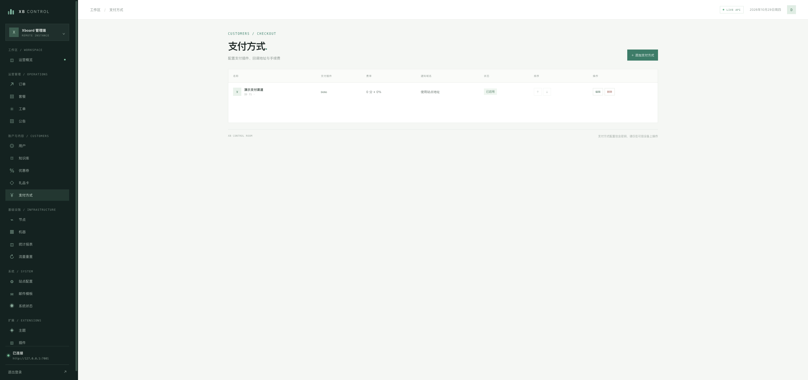</a> |
| 节点 | [/#/servers](https://xbamdin.vercel.app/#/servers) | <a href="docs/screenshots/11-servers.png">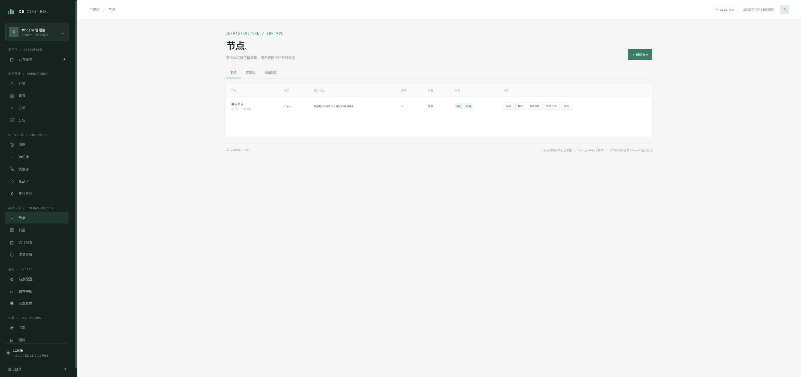</a> |
| 机器 | [/#/machines](https://xbamdin.vercel.app/#/machines) | <a href="docs/screenshots/12-machines.png">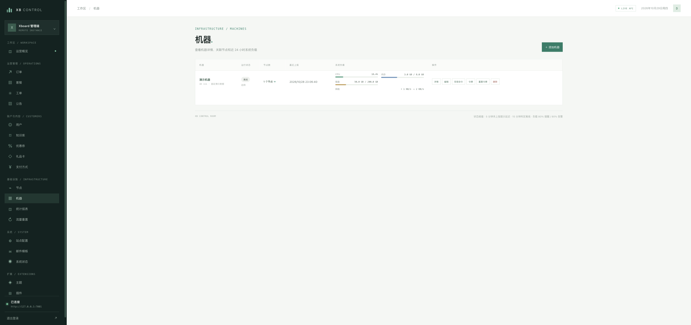</a> |
| 统计报表 | [/#/statistics](https://xbamdin.vercel.app/#/statistics) | <a href="docs/screenshots/13-statistics.png">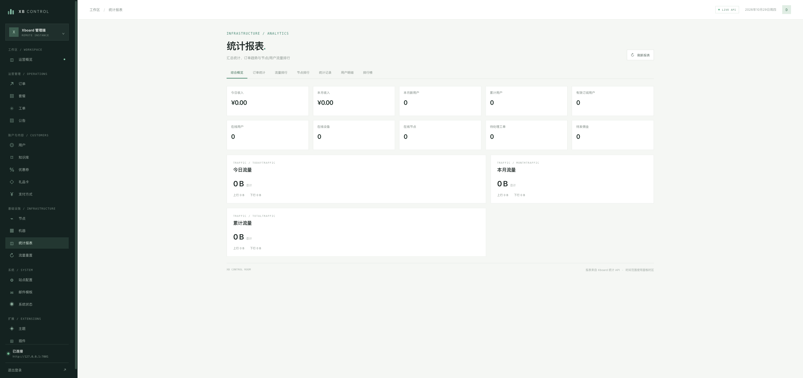</a> |
| 流量重置 | [/#/traffic-reset](https://xbamdin.vercel.app/#/traffic-reset) | <a href="docs/screenshots/14-traffic-reset.png">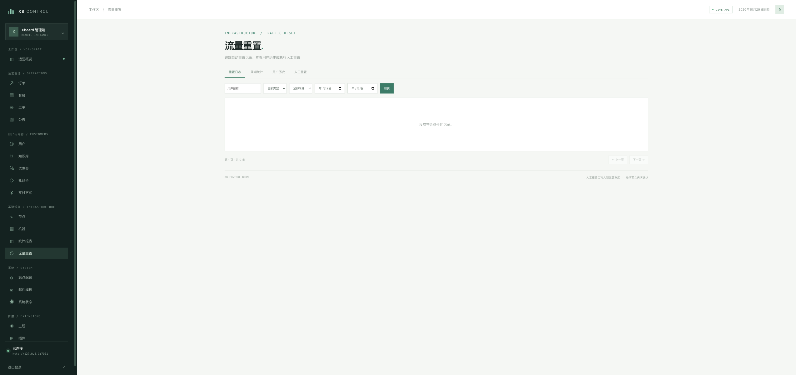</a> |
| 站点配置 | [/#/configuration](https://xbamdin.vercel.app/#/configuration) | <a href="docs/screenshots/15-configuration.png">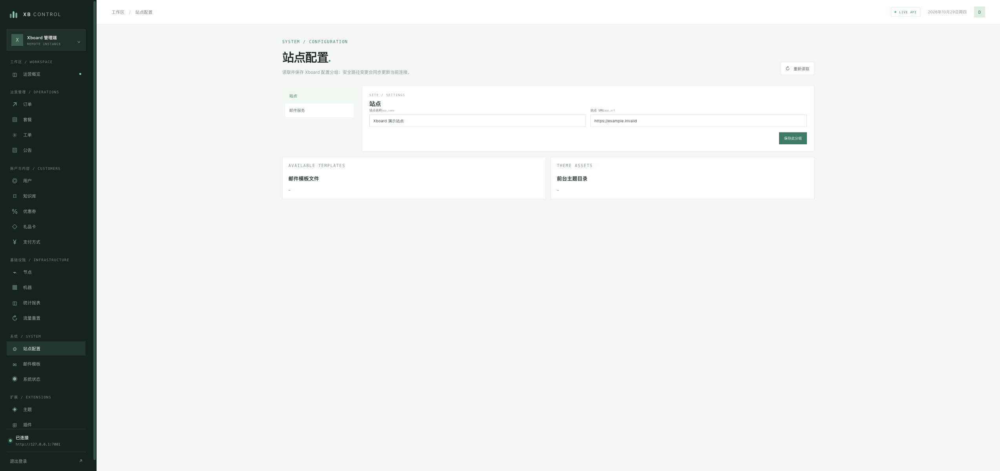</a> |
| 邮件模板 | [/#/mail](https://xbamdin.vercel.app/#/mail) | <a href="docs/screenshots/16-mail.png">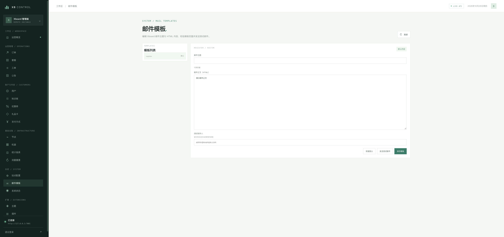</a> |
| 系统状态 | [/#/system](https://xbamdin.vercel.app/#/system) | <a href="docs/screenshots/17-system.png">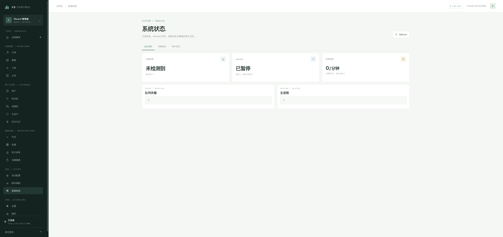</a> |
| 主题 | [/#/themes](https://xbamdin.vercel.app/#/themes) | <a href="docs/screenshots/18-themes.png">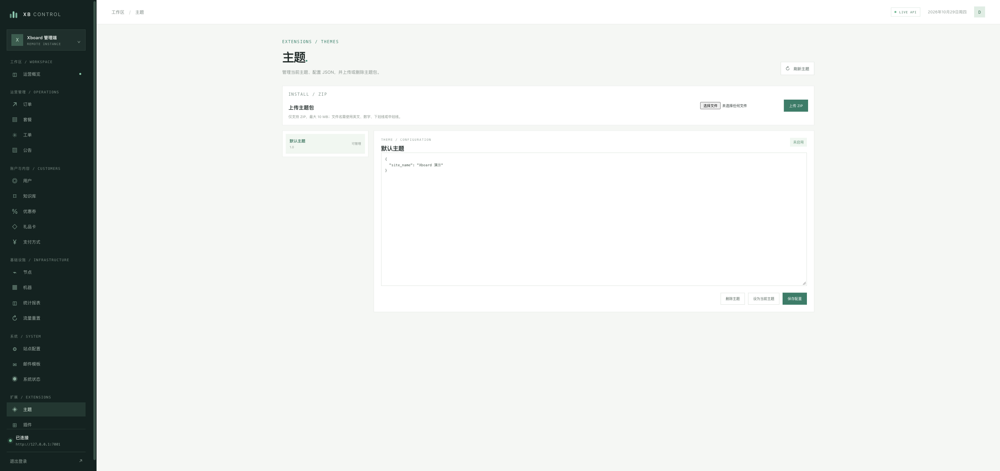</a> |
| 插件 | [/#/plugins](https://xbamdin.vercel.app/#/plugins) | <a href="docs/screenshots/19-plugins.png">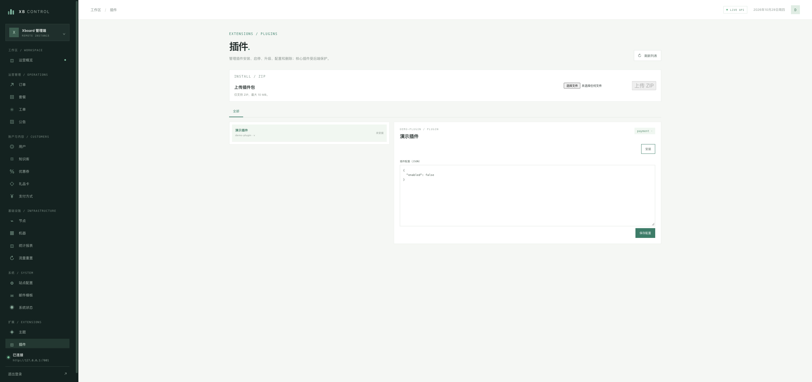</a> |

## 功能与迁移状态

目前包含运营概览、订单、套餐、工单、公告、用户、知识库、优惠券、礼品卡、支付方式、节点/分组/线路、机器、统计报表、流量重置、站点配置、邮件模板、系统状态、主题和插件等功能页。接口明细、迁移顺序及后端缺失项见 [MIGRATION.md](./MIGRATION.md)。

面向二次开发的登录认证、请求/响应格式、分页/上传下载约定和完整管理接口目录见 [Xboard Admin API 开发参考](./docs/ADMIN_API.md)。

当前 Xboard 后端还存在 3 个路由与控制器实现不匹配的接口：`user/setInviteUser`、`notice/update`、`stat/getRanking`。另外，构建通过只代表前端代码可打包；连接目标 Xboard 后仍需用测试实例逐页验收。

## 安全提示

- 不要提交 `.env.local`、管理员密码、会话令牌、数据库导出或真实业务数据。
- 所有管理 API 请求由当前浏览器直接发往 Xboard；部署前需确认 CORS、HTTPS 和网络访问策略。
- 删除用户、机器、支付方式等写操作有确认提示；继续在真实实例操作前应确认连接地址和目标账号。
